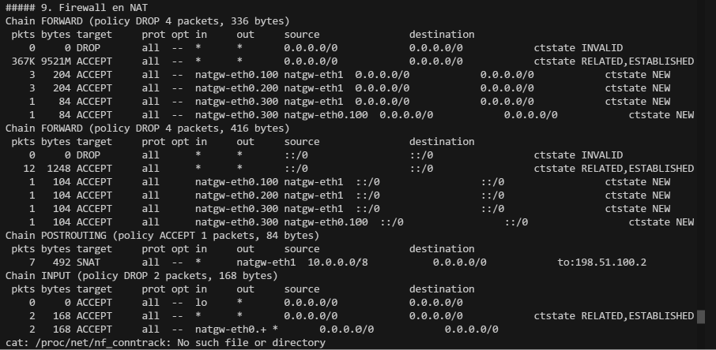
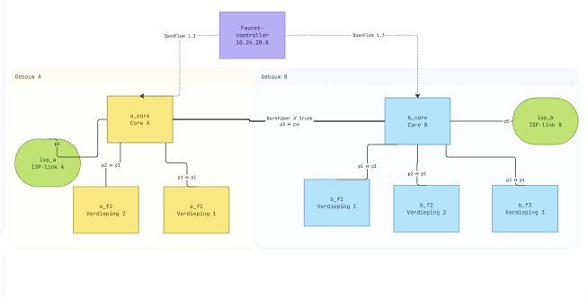

# oplevering
* Hoe je netwerk is opgebouwd
Het netwerk bestaat uit twee gebouwen die in Mininet zijn nagebouwd met Open vSwitch. Alle zeven switches praten OpenFlow 1.3 en worden beheerd door één Faucet-controller (versie 1.10.12) op een aparte VM (10.24.20.8:6653).

Gebouw	Switch	DPID	Rol
A	a_core	0x1	centrale patchkast, darkfiber en uplink naar de gateway
A	a_f1, a_f2	0x2, 0x3	verdieping 1 en 2
B	b_core	0x4	centrale patchkast op de begane grond
B	b_f1, b_f2, b_f3	0x5, 0x6, 0x7	verdieping 1 tot en met 3

Poortindeling. Elke verdiepingsswitch heeft dezelfde indeling: poort 1 is de trunk naar de core, poort 2 is een werknemerpoort, poort 3 een gastpoort en poort 4 een managementpoort. De cores hebben poort 1 tot en met 3 (2 in gebouw A) naar de verdiepingen. a_core poort 3 en b_core poort 4 vormen samen de darkfiber, en a_core poort 4 gaat naar de gateway.

Segmenten

VLAN	Doel	IPv4	IPv6
100	werknemers	10.0.100.0/23	2001:db8:100::/64
200	gasten	10.0.200.0/24	2001:db8:200::/64
300	management	10.0.30.0/24	2001:db8:300::/64

Gateway en ISP. natgw is een Linux-host met één subinterface per VLAN op a_core poort 4. Daarachter ligt het publieke segment 198.51.100.0/28 met isp_a (.1), natgw (.2) en isp_b (.3). Dit segment hangt aan isp_net, een gewone bridge zonder controller.

Per verdieping staat één testhost per VLAN, in totaal 15, met korte namen zoals a1_emp, a1_gst en a1_mgt.

* Welke keuzes je hebt gemaakt en waarom
Keuze	Technische onderbouwing
OpenFlow 1.3 met Faucet	Faucet vertaalt een YAML-configuratie naar een vaste tabelstructuur. Het ontwerp is daarmee declaratief, reproduceerbaar en uitbreidbaar, en geen losse verzameling handmatige flows

Eén controller voor beide gebouwen	Eén plek voor beleid, één logboek en minder kans op inconsistente configuratie. Voor een prototype is dat beheersbaarder dan twee controllers. Redundantie is een uitbreiding

Een core plus een switch per verdieping	Spiegelt de beschrijving van de patchkasten. Elke verdieping heeft één uplink, en VLAN’s worden over de core en de darkfiber getrunkt

VLAN 100, 200 en 300	Eén VLAN per doelgroep, zodat het beleid per poort en per segment kan verschillen

Werknemers in een /23	
Een /23 heeft 510 bruikbare adressen en past daarmee bij de eis van minimaal 500 gelijktijdige gebruikers. Gasten en management hebben een /24

Router, NAT en firewall op natgw
De gateway bundelt alle L3-functies op één plek. Hij is eenvoudig aan te tonen met teller-uitvoer van iptables en is los van de switches te vervangen

Eén gedeeld publiek adres met PAT	Het /28 biedt 16 adressen, waarvan 14 bruikbaar. Met SNAT (PAT) deelt iedereen 198.51.100.2, waardoor 500 gebruikers via één adres naar buiten kunnen. De rest blijft over voor eigen servers

Eén gedeelde uplink op a_core	Eén publiek /28 betekent één NAT-punt. Een tweede uplink in gebouw B zou een tweede /28 of een routering tussen twee gateways vragen

isp_net zonder controller	Het ISP-segment hoort niet bij het campusnetwerk. Een gewone bridge simuleert de ISP-kant zonder Faucet-configuratie

* Hoe je segmentatie en NFV hebt geïmplementeerd

Hoe ik segmentatie en NFV heb geïmplementeerd
VLAN-segmentatie

In Faucet.yml zijn de poorten als volgt ingericht:

yaml
a_f1:
    dp_id: 0x2
    interfaces:
        1: {tagged_vlans: [office, guest, management]}   # trunk
        2: {native_vlan: office,     acls_in: [office-acl]}
        3: {native_vlan: guest,      acls_in: [guest-acl]}
        4: {native_vlan: management, acls_in: [port-security-a1-mgt]}

Een hostpoort (native_vlan) stuurt ongetagd verkeer en Faucet plaatst het in het VLAN van de poort. Trunkpoorten dragen alle drie de VLAN’s getagd, ook over de darkfiber. In de flows zie je dat in tabel 1:

text
table=1, in_port="a_f1-eth3",vlan_tci=0x0000/0x1fff
  actions=push_vlan:0x8100,set_field:4296->vlan_vid,goto_table:2

Waarde 4296 is 0x1000 plus 200: VLAN 200 met het VLAN-aanwezig-bit. Employee gebruikt 4196 en management 4396.

Aangetoond. Werknemers in gebouw A en B bereiken elkaar over de darkfiber (a1_emp naar b3_emp), net als de managementhosts. Verkeer tussen VLAN’s loopt niet meer via L2: het moet via natgw, waar het beleid wordt toegepast.

NFV 1: rate limiting voor het gastennetwerk

Een OpenFlow-meter beperkt het gastverkeer, gekoppeld aan de gast-ACL:

yaml
meters:
    guest-rate-limit:
        meter_id: 1
        entry:
            flags: [KBPS, BURST, STATS]
            bands: [{type: DROP, rate: 1000, burst_size: 100}]

Op de switch staat dit als meter=1 kbps burst stats bands=type=drop rate=1000 burst_size=100, en in de flow als actions=meter:1,goto_table:1 (a_f1 poort 3). Ik koos een meter in plaats van tc, omdat de limiet daarmee in de datapath zelf zit en in de flow-dump zichtbaar is.

Aangetoond. iperf van een gast naar de ISP haalt 1,08 en 1,51 Mbit/s. Een werknemer haalt in dezelfde omgeving 15,2 Gbit/s. De absolute waarden zijn software-snelheden binnen Mininet. Het verschil toont de limiet aan.

NFV 2: Ethernet port security voor het management-VLAN

Elke managementpoort heeft een ACL met het enige toegestane bron-MAC-adres:

yaml
port-security-a1-mgt:
    - rule: {eth_src: "02:00:00:00:30:11", actions: {allow: 1}}
    - rule: {actions: {allow: 0}}

In de flows zie je twee regels: priority=20480,in_port="a_f1-eth4",dl_src=02:00:00:00:30:11 actions=goto_table:1 laat het toegestane MAC door, en priority=20479,in_port="a_f1-eth4" actions=drop dropt al het andere.

Aangetoond. Een ping van a1_mgt naar de gateway werkt. Na het wijzigen van het MAC naar 02:00:00:00:99:99 faalt de ping en telt de dropregel 2 pakketten. Na terugzetten werkt de ping weer.

Schaalbaarheid en /28

Het script tests/scale_test.sh geeft a1_emp 500 extra adressen uit de /23 en laat ze tegelijk pingen naar de ISP. Uitkomst: 500 van 500 zonder verlies, een nf_conntrack_count van 500 en een SNAT-teller die van 3 naar 503 stijgt. Alle verbindingen verlaten het netwerk als 198.51.100.2.

Beperking: de 500 bronadressen komen van één host met één MAC. De test bewijst PAT en conntrack voor 500 gelijktijdige verbindingen en de adrescapaciteit van de /23. Hij bewijst niet dat Faucet 500 aparte MAC’s leert.

* Screenshots of dumps van flow tables (via dpctl dump-flows of vergelijkbaar)

* Diagram of schematische netwerktekening

commands voor flows

text
a1_gst ping -c3 198.51.100.1
a1_gst ping -c3 -W1 10.0.200.12
a1_gst ping -c3 -W1 10.0.100.11
a1_mgt ping -c3 10.0.30.254
a1_mgt ip link set a1_mgt-eth0 address 02:00:00:00:99:99
a1_mgt ping -c3 -W1 10.0.30.254
a1_mgt ip link set a1_mgt-eth0 address 02:00:00:00:30:11
iperf a1_gst isp_a
1. Alle switches in één keer (dpctl)
text
dpctl dump-flows -O OpenFlow13

Dit toont de flows van alle acht switches, ook van isp_net. De uitvoer is erg lang, dus gebruik dit vooral als bewijs dat alle switches regels hebben. Voor je portfolio zijn de gefilterde dumps hieronder beter.

2. Eén switch volledig

sh ovs-ofctl -O OpenFlow13 dump-flows a_f1
sh ovs-ofctl -O OpenFlow13 dump-flows a_core
sh ovs-ofctl -O OpenFlow13 dump-flows b_core
3. Per tabel (voor de uitleg van de tabelverdeling)

sh ovs-ofctl -O OpenFlow13 dump-flows a_f1 table=0
sh ovs-ofctl -O OpenFlow13 dump-flows a_f1 table=1
sh ovs-ofctl -O OpenFlow13 dump-flows a_f1 table=2
sh ovs-ofctl -O OpenFlow13 dump-flows a_f1 table=3
sh ovs-ofctl -O OpenFlow13 dump-flows a_f1 table=4

Tabel 0 is de poort-ACL, 1 de VLAN-classificatie, 2 het leren van bron-MAC’s, 3 het doorsturen op doel-MAC en 4 flooding.

4. Per feature

VLAN-segmentatie (hostpoort krijgt een VLAN-tag):

sh ovs-ofctl -O OpenFlow13 dump-flows a_f1 table=1

Rate limiting gasten (meter en de flows die hem gebruiken):

sh ovs-ofctl -O OpenFlow13 dump-meters a_f1
sh ovs-ofctl -O OpenFlow13 meter-stats a_f1
sh ovs-ofctl -O OpenFlow13 dump-flows a_f1 table=0 | grep meter

Met meter-stats zie je ook hoeveel pakketten de meter heeft gedropt.

Port security management (toegestaan MAC en de catch-all drop):

sh ovs-ofctl -O OpenFlow13 dump-flows a_f1 table=0 | grep 'a_f1-eth4'

Gastisolatie (drops naar andere VLAN’s en de toegestane regels):

sh ovs-ofctl -O OpenFlow13 dump-flows a_f1 table=0 | grep 'a_f1-eth3'

Trunk en darkfiber (VLAN-verkeer tussen de gebouwen):
sh ovs-ofctl -O OpenFlow13 dump-flows a_core table=0
sh ovs-ofctl -O OpenFlow13 dump-flows b_core table=0
