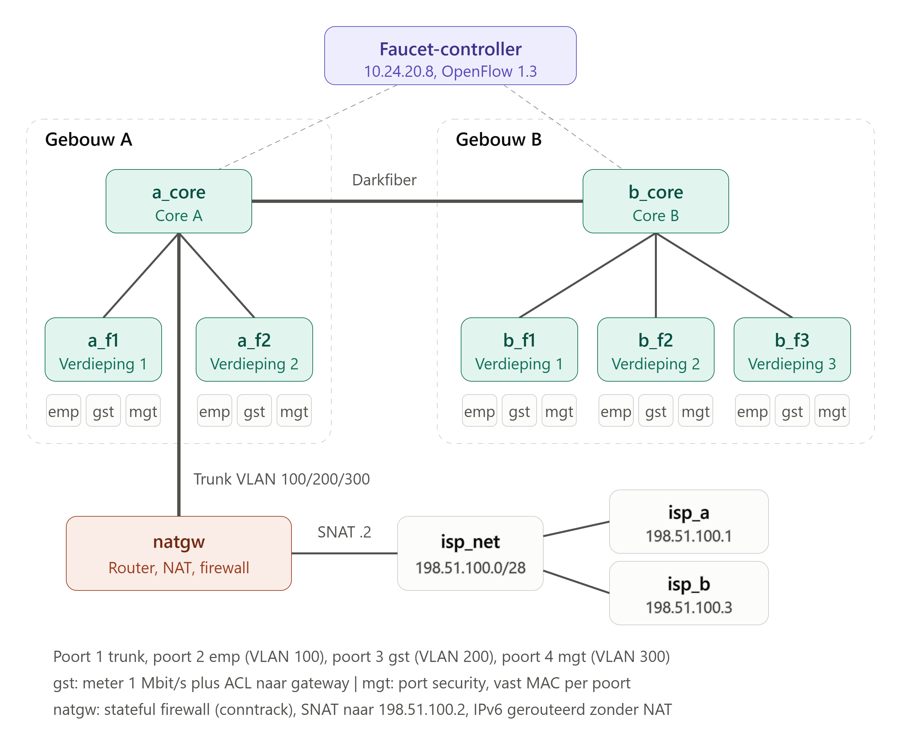

* Netwerktekening

# uitleg
* Per feature de overwegingen en werking

In de VLAN-blokken staan geen faucet_vips meer. De L3-functie ligt bij natgw, zodat het routeren, de NAT en de firewall op één plek staan.

Extra componenten. De volgende onderdelen staan in mininet_topologie.py en maken geen deel uit van de Faucet-YAML:

natgw met VLAN-subinterfaces (natgw-eth0.100, .200, .300) en de publieke kant natgw-eth1;
de iptables- en ip6tables-regels van de stateful firewall;
de SNAT-regel voor IPv4 naar 198.51.100.2;
statische IPv6-adressen en routes op hosts en ISP-hosts.

1. IPv6 per VLAN

Elk VLAN heeft een eigen /64 (2001:db8:100::/64, …:200::/64, …:300::/64) met natgw als gateway op ::1. Hosts hebben statische adressen en een default route naar die gateway. De ISP-hosts hebben terugroutes naar de drie prefixen via 2001:db8:ffff::2.

Overweging: bij IPv6 gebruik ik geen NAT. De prefixen blijven end-to-end zichtbaar, en het beleid wordt uitsluitend door de firewall bepaald. Voor een productieomgeving zou je SLAAC of DHCPv6 gebruiken in plaats van statische adressen.

Bewijs: sectie 2 (alle drie de VLAN’s pingen 2001:db8:ffff::1) en sectie 4 (management naar employee via IPv6).

2. ISP-integratie en het /28-blok

IPv4 gaat via PAT naar één publiek adres, 198.51.100.2. IPv6 wordt gerouteerd zonder NAT. De ISP kan teruggaand verkeer naar de interne prefixen sturen, maar nieuwe verbindingen worden geblokkeerd.

Bewijs: iptables -t nat met de SNAT-regel en de teller.

3. Stateful firewall

Waarom op natgw. OpenFlow 1.3 kent geen connection tracking, en Faucet exposeert het OVS-conntrack-extensiemechanisme niet. Een stateless ACL die terugverkeer toestaat op basis van TCP-flags of poortnummers is te benaderen, maar is te omzeilen met vervalste pakketten en werkt niet voor UDP en ICMP. Linux netfilter met conntrack doet dit wel correct, voor IPv4 en IPv6, en past bij de NFV-gedachte: een firewallfunctie als software op een host.

Regels. Policy DROP op FORWARD en INPUT. Daarna, in volgorde:

ctstate INVALID: drop;
ctstate ESTABLISHED,RELATED: accept;
ctstate NEW van VLAN 100, 200 en 300 naar de ISP-kant: accept;
ctstate NEW van management naar employee: accept.

Alles anders valt onder de policy. Nieuwe verbindingen van de ISP naar binnen, van employee naar management en van gast naar andere VLAN’s worden daardoor geblokkeerd.

* Screenshots of dumps van relevante flow tables
Onderdeel	            Commando	                               Wat te zien is
Gastbeleid	    dump-flows a_f1, in_port="a_f1-eth3"	        meter-regels en drops met tellers
Port security	dump-flows a_f1, in_port="a_f1-eth4"	        toegestaan MAC en catch-all drop
Meter	        dump-meters a_f1	                            rate=1000 burst_size=100
Firewall	    iptables -L FORWARD -n -v, ip6tables -L FORWARD -n -v	ESTABLISHED-teller en policy DROP
NAT         	iptables -t nat -L POSTROUTING -n -v	            SNAT-teller
Core-flows	    dump-flows a_core	                            VLAN-tabel, leren en forwarding

* Eventuele zelfgeschreven scripts/configuratiehulp
zie 500usertest.bash.

